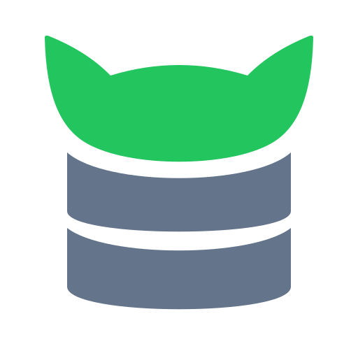

<div align="center">



# DataGoblin

### Write SQL. Follow the relationships. Edit the results.

A focused desktop SQL workspace for **PostgreSQL** and **Microsoft SQL Server**.<br />
Built for developers who want to get from a query to an answer—and back to work.

[](https://github.com/Ceusters-be/DataGoblin/releases/latest)
[](https://github.com/Ceusters-be/DataGoblin/actions/workflows/build.yml)
[](#install)

**[Download DataGoblin](https://github.com/Ceusters-be/DataGoblin/releases/latest)** · **[Features](#features)** · **[Quick start](#your-first-query)** · **[Development](#development)**

</div>

---

## A small workspace with a useful trick

Query across related tables, then **edit values directly in the JOIN results**. DataGoblin maps supported cells back to their source tables, shares edits across repeated source rows, and applies the changes together in a transaction.

Around that sits a SQL editor, a selective database explorer, a query library and a results grid that loads data in manageable batches.

> **Early access.** DataGoblin is actively developed for a small team. Start with a development database and review pending changes before applying them.

## Install

Open the **[latest release](https://github.com/Ceusters-be/DataGoblin/releases/latest)** and expand **Assets**. The release badge above always shows the latest published version.

| Your computer | Download | Installation |
| :--- | :--- | :--- |
| **Windows · x64** | `DataGoblin_…_x64-setup.exe` | Run the installer. An `.msi` is also available. |
| **macOS · Apple Silicon** | `DataGoblin_…_aarch64.dmg` | Open the disk image and drag DataGoblin into Applications. |
| **macOS · Intel** | `DataGoblin_…_x64.dmg` | Open the disk image and drag DataGoblin into Applications. |
| **Linux · x64** | `DataGoblin_…_amd64.AppImage` | Make the file executable, then launch it. |
| **Debian / Ubuntu · x64** | `DataGoblin_…_amd64.deb` | Install using your package manager. |
| **Fedora / RPM-based · x64** | `DataGoblin-….x86_64.rpm` | Install using your package manager. |

Use the `.dmg` for a normal macOS installation. The `.app.tar.gz`, `.sig` and `latest.json` files support automatic updates; you do not need to open them manually.

<details>
<summary><strong>Linux installation commands</strong></summary>

Replace the example filename with the file you downloaded.

```bash
# AppImage
chmod +x ./DataGoblin_VERSION_amd64.AppImage
./DataGoblin_VERSION_amd64.AppImage

# Debian / Ubuntu
sudo apt install ./DataGoblin_VERSION_amd64.deb

# Fedora
sudo dnf install ./DataGoblin-VERSION-1.x86_64.rpm
```

A desktop Secret Service provider, such as GNOME Keyring, is needed to remember database passwords.

</details>

<details>
<summary><strong>Windows or macOS blocks the first launch?</strong></summary>

Current releases are not signed with an OS publisher certificate or notarized by Apple. Signed update packages are a separate mechanism.

- **Windows:** SmartScreen may show an unknown-publisher warning. For a release you downloaded from this repository and trust, use **More info → Run anyway**, if company policy allows it.
- **macOS:** after copying the app into Applications and attempting to open it, check **System Settings → Privacy & Security → Open Anyway**. macOS may also display an “app is damaged” message; that message alone does not identify the cause.

For a trusted copy from this repository, this command removes the download quarantine only from DataGoblin:

```bash
xattr -dr com.apple.quarantine "/Applications/DataGoblin.app"
```

If it still will not open, collect this output when reporting the problem:

```bash
codesign --verify --deep --strict --verbose=2 "/Applications/DataGoblin.app"
```

Managed company devices may require IT approval. See [Apple’s guidance](https://support.apple.com/en-us/102445).

</details>

### Updates without another download page

DataGoblin checks for updates on startup and every four hours, downloads the signed update, and offers **Restart to update** in the top bar. You can also check manually with **Updates**.

Restarting waits until queries and result operations are finished, pending grid edits are applied or reverted, and query saving succeeds. For Linux in-app updates, use the AppImage; `.deb` and `.rpm` users can install a newer package.

## Features

| | What you can do |
| :--- | :--- |
| **SQL editor** | Dialect-aware highlighting and formatting, current-query outlines, snippets, and completion that understands aliases and subquery scopes. |
| **Foreign-key-aware completion** | Get JOIN suggestions with `ON` conditions from available foreign-key metadata. |
| **Editable JOIN results** | Update supported values from multiple source tables in one transaction, with a preview of pending changes. |
| **Selective explorer** | Choose which databases and schemas to load. Browse tables, views and routines without loading every object's metadata up front. |
| **Results you can work with** | Sort, filter, resize columns, inspect cell values, copy selections and export the displayed rows to CSV. |
| **Progressive loading** | Page through results or choose All to fetch in batches of **500 rows**, with progress in the pager. |
| **Relationship navigation** | Follow supported foreign-key cells to referenced records in a new query tab. |
| **Queries that stay with you** | Autosaved SQL files, recovery drafts, searchable query history, and a library grouped by server and database. |
| **Vim, when you want it** | Optional modal editing with motions, operators, undo and `:w`. Enable it under **Settings → Editor**. |
| **Your workspace** | Daylight, Midnight or System theme, resizable panels, keyboard shortcuts and custom context menus. |

### Edit across a JOIN

```sql
select *
from Agreement a
inner join AgreementPartyRole apr
    on a.AgreementId = apr.AgreementId;
```

1. Run a supported `SELECT *` with `JOIN` or `INNER JOIN` across different base tables.
2. Double-click an editable, non-key cell in the results.
3. Review the pending changes and their source tables.
4. Apply them together. A detected conflict or failed constraint rolls back the submission.

Each source table needs a supported primary key. Composite keys and multiple INNER JOINs are supported. Outer joins, self-joins, views, aggregates, explicit projections and subqueries remain read-only in this editing flow. Hover **Read-only result** for the reason when editing is unavailable.

## Your first query

1. Click **+** in Explorer and choose **PostgreSQL** or **SQL Server**.
2. Enter the server, database and credentials. Test the connection, then save it.
3. Click the count beside the server to select databases, then the count beside a database to select schemas.
4. Open a new query from the context menu, or use a table’s query action.
5. Write SQL and press **Ctrl+Enter** on Windows/Linux or **⌘+Enter** on macOS.

SQL Server starts with `master` and `dbo` selected. PostgreSQL uses the configured database and `public`. TLS certificate verification is enabled by default; adjust it only to match your server setup.

### Keep your hands on the keyboard

Use **⌘** in place of **Ctrl** on macOS for the shortcuts below.

| Shortcut | Action |
| :--- | :--- |
| `Ctrl+Enter` | Run the selection or current query |
| `Ctrl+Alt+L` | Format SQL |
| `Ctrl+S` | Save queries |
| `Ctrl+/` | Toggle a line comment |
| `Ctrl+F` | Find in the editor |
| `Ctrl+,` | Open settings |
| `Ctrl+Shift+H` | Open query history |
| `sel` → `Tab` | Expand a lowercase `select * from …;` snippet |

For completion, use **Ctrl+Space**. The in-app shortcuts dialog lists additional workspace commands.

## Local files. Native credential storage.

Saved query files, history and preferences stay on your machine. Remembered database passwords use **Windows Credential Manager**, **macOS Keychain** or **Linux Secret Service**; connection profiles contain no password field.

Choose your query folder in **Settings → Query storage**. Back up the whole folder, including its hidden `.datagoblin` directory. SQL files and recovery drafts may contain sensitive query text—they are not a credential vault.

## Development

The desktop shell is **Tauri 2**, with a **Rust** backend and a **Nuxt 4 / Vue 3 / TypeScript** interface. The SQL editor uses **CodeMirror 6**. The frontend is bundled into the desktop app; no Node.js server is required to run an installed release.

Install Node.js 22.12+ or a compatible newer LTS, Rust stable, and the [Tauri prerequisites](https://v2.tauri.app/start/prerequisites/) for your OS.

```bash
git clone https://github.com/Ceusters-be/DataGoblin.git
cd DataGoblin
npm ci
npm run desktop
```

<details>
<summary><strong>Build and test commands</strong></summary>

```bash
npm test
npm run build
cargo test --locked --manifest-path src-tauri/Cargo.toml
node --test scripts/check-update-manifest.test.mjs
npm run tauri -- build
```

`npm run dev` opens the frontend development server on port `1420`. Database access and native filesystem features require the desktop app.

Installers from a local build are written to `src-tauri/target/release/bundle/`. Build on the target operating system. Use `npm run tauri -- build --debug --no-bundle` for a development executable.

</details>

## A few things to know

- Each execution opens a fresh database connection. Run statements together in one batch when they depend on shared session state, temporary tables or transactions.
- Running another query discards pending grid edits. Apply edits first if you want to keep them.
- All-data loading has resource limits; it is not an unlimited database export. CSV export includes the displayed page.
- Windows integrated/Entra authentication and SSH tunnels are not currently implemented.
- SQL Server `GO` batch separators are not supported by the statement splitter. Select the intended SQL or use Run all where appropriate.

## Go deeper

- **[Workspace guide](docs/workspace-guide.md)** — editing rules, storage, browsing, shortcuts and implementation details.
- **[Release guide](docs/releases.md)** — version tags, installers, update signing and GitHub Actions.
- **[Report an issue](https://github.com/Ceusters-be/DataGoblin/issues)** — include your app version, operating system and steps to reproduce. Remove credentials and private data from SQL or screenshots.

---

<div align="center">

**DataGoblin** · PostgreSQL + SQL Server · Windows + macOS + Linux

[Get the latest release →](https://github.com/Ceusters-be/DataGoblin/releases/latest)

</div>
